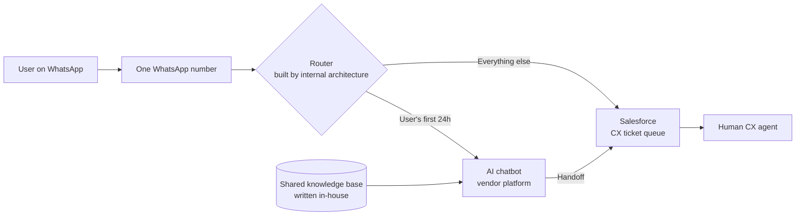
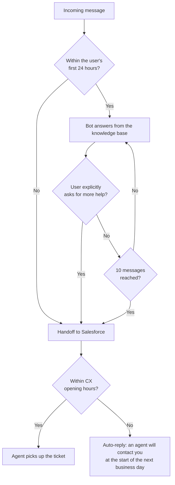
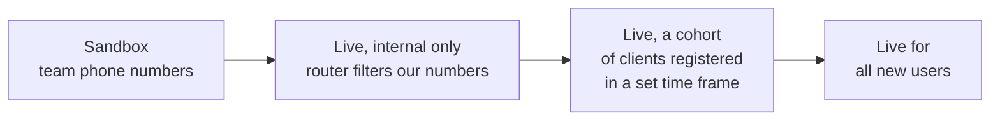

# AI onboarding chatbot on WhatsApp: a delivery case study

How I took an AI chatbot from business case to a live, cross-country launch at a Latin American fintech, and what it did to activation and support load.

> **About this repo.** This is a reconstructed case study, not production code. The company is not named, and there is no internal data, real prompts or screenshots. Numbers are the ones I can stand behind; where I don't remember a figure precisely, I leave it out.

| | |
|---|---|
| **Company** | Cross-border fintech operating in six Latin American countries |
| **My role** | Project owner, from business case to post-launch iteration |
| **Timeline** | About 2 months of build (December to mid-February), after approval |
| **Team** | My manager, an external chatbot vendor, the head of architecture, a Salesforce developer, CX leadership |
| **Result** | 24-hour activation from ~48% to ~55% vs control (~15% relative lift), 30% fewer tickets handled by CX |

---

## 1. Context

- **Activation** was defined as a user's first transaction: a card payment, an international transfer or a currency exchange.
- The largest drop in the funnel was at activation: users who completed sign-up and identity verification (KYC) but never transacted.
- New users had many simple questions right after creating their account: *can I send money to country X?*, *how is the exchange rate calculated?*, *how do I load money?*
- Before the chatbot, an external call center handled part of this demand. I joined with it already running, trained the team and listened to a random sample of calls to learn what users were actually asking.
- The CX team was overloaded: **queues of up to 20 hours.** in rushing times.

## 2. The business case

My manager and I were AI-native from the start, and the pattern was obvious: most early questions were simple and repetitive, which is exactly what an AI assistant can answer. My manager escalated the idea and gave me ownership.

The case rested on three points:

1. **CX was collapsing.** Queues of up to 20 hours, while new users needed answers in their first hours.
2. **Activation was the biggest drop in the funnel**, and unanswered early questions were part of the cause.
3. **Hiring was not a real alternative.** The project's cost would have paid for only three extra CX agents, irrelevant against the demand.

I presented it with my manager. It had already been discussed informally with the key people, so it entered the roadmap quickly.

## 3. The solution

- **Vendor platform.** We had no internal capability to connect to frontier AI models, so we bought instead of building. The vendor provided the conversational AI and built the full integration with our systems. They did not disclose which model they used.
- **Knowledge base.** We wrote and maintained the shared knowledge base the bot answered from.
- **Salesforce.** CX agents already handled WhatsApp conversations as Salesforce tickets. Before the chatbot, every WhatsApp message went straight to a human through Salesforce.
- **Router.** Decided whether a conversation went to the bot or to Salesforce. Each user's first 24 hours went to the bot, because that window concentrates simple questions and few transaction issues.

### Handoff rules

### Guardrails

The bot was explicitly not allowed to:

- promise prices or exchange rates,
- talk about returns or profitability,
- describe transfer routes it did not know,
- explain anti-money-laundering (AML) rules,
- among other restricted topics.

## 4. Delivery

I owned the project without formal authority over any of the teams involved, so most of the work was indirect influence.

| Stakeholder | What I needed from them | How we worked |
|---|---|---|
| My manager | Escalating blockers | Progress updates and a shared task tracker |
| Chatbot vendor | Bot, AI and integration | Recurring progress meetings |
| Head of architecture | The router | Direct relationship, frequent early meetings |
| Salesforce developer | Salesforce side of the integration | Meetings to map what was missing and what was breaking |
| CX leadership | Trust in sharing their channel | QA sessions and tests |
| CEO and key stakeholders | Visibility after launch | Usage reporting |

I also ran joint sessions with everyone in the room. Day-to-day coordination happened over Slack and email.

### The hardest call: one WhatsApp number

Keeping a single number was much better for users: no new contact to save, no confusion about where to write. But it meant the router had to work flawlessly with Salesforce, the vendor and every routing rule. We dropped the two-number option. **Without solving this, the project would not have gone ahead.**

### The hardest negotiation: Salesforce and CX

CX and the Salesforce owner were understandably nervous: the bot would live on their channel, and any failure could take their main support line down. Getting their priority meant proving it was safe, through many rounds of QA and testing.

## 5. Testing and rollout

Each phase widened exposure only after the previous one was stable.

## 6. Post-launch QA and iteration

The first priority was always the same: **the bot must never give wrong information.** In the first weeks I reviewed several conversations every day, looking for errors, broken logic and hallucinations.

**Example 1: unsupported countries.** The most critical failure was questions about countries we didn't send money to. The knowledge base only described what *was* possible, so the bot sometimes filled the gap. The fix was to state explicitly what does *not* exist, not only what does.

**Example 2: available currencies.** Simpler, but users get lost in the currencies that they can support and how to add money to the wallet depending on their nationality.

**Example 2: how the pricing works.** Remittance is difficult to understand at the beginning, and users do not clearly understand if the cost is on the exchange rate or the transaction cost. And also, this varies per product, causing more confusion for the user. The chatbot solves most of those questions.

> TODO: one or two more examples of an error found in review and how the prompt or knowledge base changed.

There were **20+ iterations** of the prompt and the knowledge base. The scope never had to be cut; the improvements came from training the prompt.

## 7. Measurement

**Design.** A 50/50 split of new users:

- **Treatment:** a proactive welcome message inviting them to make their first transaction and ask any question, answered by the chatbot.
- **Control:** no welcome message, no chatbot.

**Primary metric:** activation (first transaction) within 24 hours.

**Support load:** measured as tickets handled by the CX team. This was the better measure, because a conversation the bot could not resolve still created a CX ticket.

**Tracking:** first in Excel, then a real-time Tableau dashboard.

### Results

- 24-hour activation went from **about 48% in control to about 55% in treatment**: a **~15% relative lift** (7 percentage points).
- **30% fewer tickets** handled by CX.

### Limitations

- **The treatment was a bundle.** Treated users got a proactive message *and* the chatbot, so the lift is the effect of both together, not of the bot alone.
- Rates are approximate, from memory of the dashboard; I no longer have access to the underlying data.

## 8. What happened next

Two weeks after launch, the bot was also taking CX and customer service questions **in all six countries**, well beyond the original onboarding scope.

---

*Built and documented by Tomás Mora. [Portfolio](TODO) · [LinkedIn](https://www.linkedin.com/in/tomas-mora-c)*
